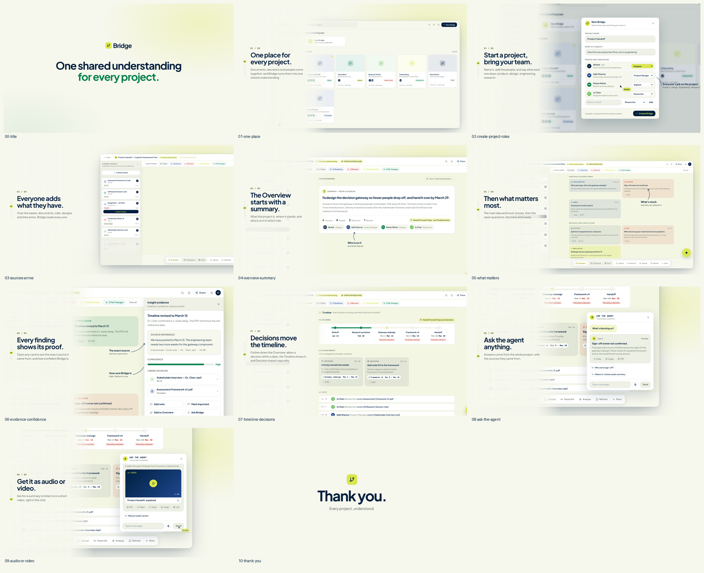

# Bridge product demo video

A 1 min 52 s product demo of Bridge, made from the real Bridge app in this repo, plus everything used to make it.
Change the words, the timing or the screens, and render your own cut.



## Watch it
- **Final video:** [`output/bridge-product-demo.mp4`](output/bridge-product-demo.mp4) (full quality, 1080p, 60 fps)
- **Share copy:** [`output/bridge-product-demo-share.mp4`](output/bridge-product-demo-share.mp4) (smaller, for chat and email)
- **A still of every scene:** [`output/stills/`](output/stills)

When you share the film, add the music credit its licence asks for:
**"Music: Sascha Ende, ende.app (CC BY 4.0)"**.

## Browse it
Serve this folder, then open the two pages:
```
cd demo-video
npx serve .            # or: python3 -m http.server 8000
```
- **`index.html`**: every scene with its still, time, caption, what happens, and links to the real screen it uses.
- **`player.html`**: the live film. Scrub, play with sound, jump to any chapter. It reloads your edits.

(The pages need a local server because browsers block the frozen screens on `file://`.)

## What the film shows
| # | Scene | Bridge feature |
|---|---|---|
| 00 | Title | "One shared understanding for every project." |
| 01 | One place for every project. | Home |
| 02 | Start a project, bring your team. | New Bridge: name it, add people with their job role |
| 03 | Everyone adds what they have. | Sources arriving over the weeks |
| 04 | The Overview starts with a summary. | Overview: summary, people and roles |
| 05 | Then what matters most. | Main idea, must-know, questions, blockers, needs |
| 06 | Every finding shows its proof. | Insight evidence: the source line and the confidence score |
| 07 | Decisions move the timeline. | Overview's Timeline: dates moved by decisions, Decision impact, Activity |
| 08 | Ask the agent anything. | Ask the agent (corner button), answers with sources |
| 09 | Get it as audio or video. | The agent hands back an audio summary or a short video |
| 10 | Thank you. | |

Full details, decisions and every round of feedback: [`STORYBOARD.md`](STORYBOARD.md).

## Edit it
Most edits are in one file, [`film/film.js`](film/film.js):
- **Words:** the `CHAPTERS` list (each scene's title and line).
- **Timing:** the `TL` table at the top (seconds, grouped by scene).
- **Notes and arrows, camera, cursor:** `schedule()`.
- **Title and thank-you card:** `init()` and the styles in [`film/index.html`](film/index.html).

To change what a screen looks like, change the app (`src/`), then re-freeze that screen.
Step-by-step instructions for every kind of edit, re-freezing, sound and rendering are in [`SKILL.md`](SKILL.md).

## Use it with Claude
Open this folder (or the repo) in Claude Code. `CLAUDE.md` points Claude to [`SKILL.md`](SKILL.md), which explains
the whole film, where everything lives and how to change it. Then just ask, for example:
- "Shorten scene 03 to 8 seconds."
- "Change the title to …"
- "Add a scene about the Workspace after scene 07."
- "Re-freeze the Overview, I changed the app, and render a new cut."

The two skills that made the film are included in [`skills/`](skills): `product-film` (the method and tools) and
`film-sound` (music and UI sounds).

## Render it
Needs Node 18+ and ffmpeg. Inside `demo-video/`: `npm install && npx playwright install chromium`, then
```
node tools/frames.mjs render/stills --every 2               # check stills first (seconds)
node tools/render.mjs render/video.mp4 --fps 60 --sub 3 --crf 16   # the master (~30 minutes)
```
Then mix and add the sound (see `SKILL.md` → Sound).

## What's real and what's sample
- **Real UI:** every product frame is a frozen page of this repo's Bridge app (`snap/`, made by `tools/snap.mjs`).
- **Sample data:** the app's built-in demo project ("Product Handoff") and its demo team. Akshat is the cursor.
  No live system was used; every write was blocked while freezing.

## Folder
```
demo-video/
├── index.html          folder map: every scene, still, screen and output
├── player.html         live player with chapters and sound
├── README.md           this file
├── SKILL.md            the full guide (for people and for Claude)
├── CLAUDE.md           points Claude Code to SKILL.md
├── STORYBOARD.md       scenes, decisions, feedback rounds
├── film/               the film: index.html (stage), film.js (script), engine.js (motion)
├── snap/               frozen screens of the real app (+ fonts)
├── shots/bridge.mjs    how each screen is frozen
├── tools/              freeze, stills, render, QA, fonts
├── audio/              sound cues and the preview mix
├── skills/             product-film and film-sound skills (music and effects included)
└── output/             final video, share copy, stills, storyboard sheet
```

## Licences
- Music: "Happy Beats / Business Moves Vol. 12" by Sascha Ende, ende.app, CC BY 4.0 (credit required).
- Sound effects: Kenney, CC0. Keypresses: unicae_games, CC0.
- Fonts: Plus Jakarta Sans and DM Mono, SIL Open Font Licence.
- The product-film and film-sound skills and their tools: free to use and change (upstream parts MIT).
